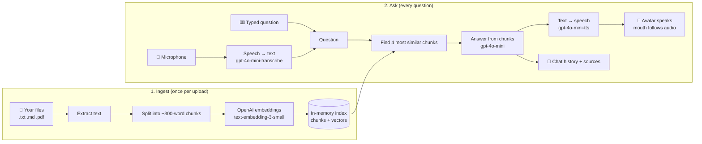
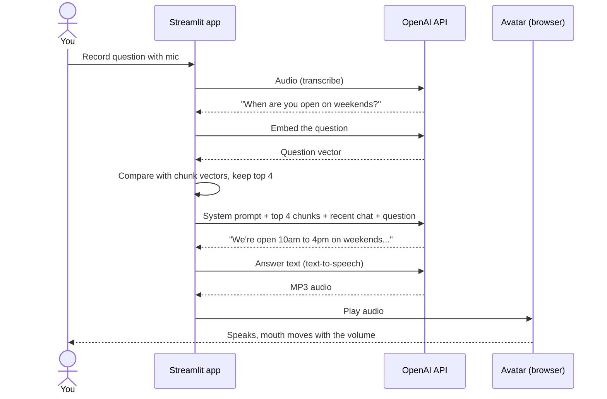
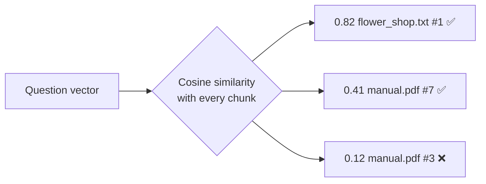
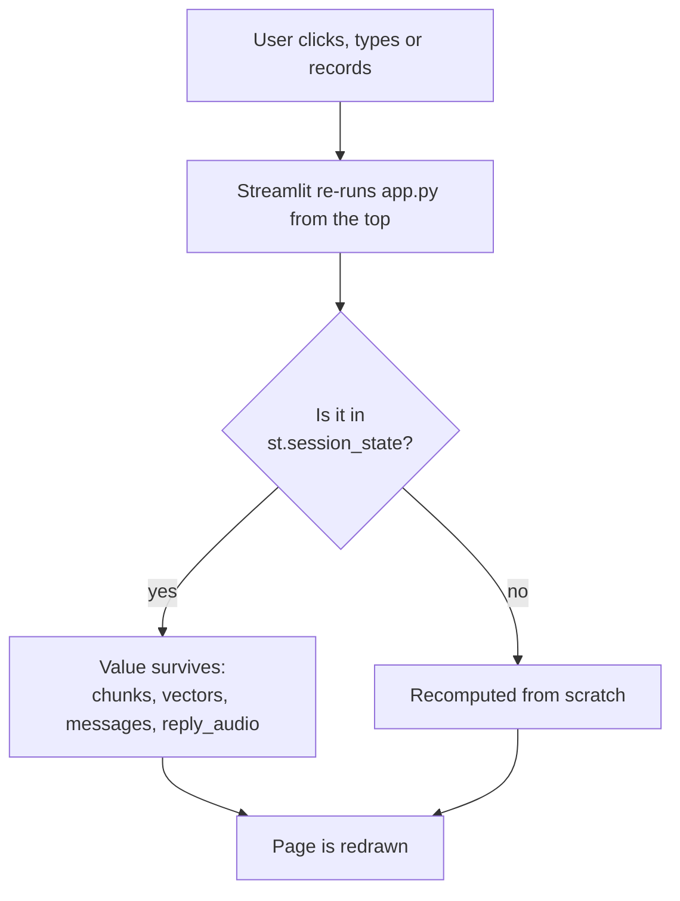

# E) Voice RAG Avatar — Streamlit + OpenAI

A simple web app where you upload documents and then **talk** to an animated avatar that answers questions from them.

- **RAG** (Retrieval-Augmented Generation): instead of answering from general knowledge, the model is given the most relevant pieces of *your* documents and told to answer only from those.
- **Voice**: you speak into the mic; the avatar answers out loud.
- **Streamlit**: turns a plain Python script into a web page, with no HTML or JavaScript needed (except for the small avatar).

---

## How it works

### The big picture



### One question, step by step



### How "find the most similar chunks" works

An **embedding** is a list of numbers (a vector) that represents the meaning of a piece of text. Texts with similar meaning get vectors that point in similar directions. The app:

1. Stores one vector per chunk when you click **Ingest**.
2. Turns your question into a vector the same way.
3. Scores every chunk with **cosine similarity** (how closely the two vectors point the same way) and keeps the best 4.



---

## What you need

- **Python 3.10 or newer**. Check with `python --version` (macOS/Linux may need `python3`; Windows may use `py`).
- An **OpenAI API key** from <https://platform.openai.com/api-keys>. Using the API costs a little money per request; a class session normally costs cents.
- A **microphone** and a recent Chrome, Edge or Firefox.

---

## Setup on macOS / Linux

```bash
# 1) Go into the project folder
cd E_5350_RAG

# 2) Create a virtual environment (an isolated set of packages just for this project)
python3 -m venv .venv

# 3) Activate it. Your prompt should now start with (.venv)
source .venv/bin/activate

# 4) Install the packages listed in requirements.txt
pip install -r requirements.txt

# 5) Create your secrets file, then open .env and paste your key after OPENAI_API_KEY=
cp .env.example .env

# 6) Start the app; it opens http://localhost:8501 in your browser
streamlit run app.py
```

## Setup on Windows

Use **PowerShell** (Start menu → type "PowerShell"). If Python isn't installed, get it from <https://www.python.org/downloads/> and tick **"Add python.exe to PATH"** in the installer.

```powershell
# 1) Go into the project folder (adjust the path to where you saved it)
cd C:\Users\<you>\Documents\furhat-ollama-lab-v2\E_5350_RAG

# 2) Create a virtual environment
py -m venv .venv

# 3) Activate it. Your prompt should now start with (.venv)
.venv\Scripts\Activate.ps1

# 4) Install the packages
pip install -r requirements.txt

# 5) Create your secrets file, then edit it in Notepad
copy .env.example .env
notepad .env

# 6) Start the app
streamlit run app.py
```

**Windows tips**

- If activation fails with *"running scripts is disabled on this system"*, run this once, then try step 3 again:
  ```powershell
  Set-ExecutionPolicy -Scope CurrentUser RemoteSigned
  ```
- Using the old **Command Prompt** (cmd) instead? Activate with `.venv\Scripts\activate.bat`.
- If `py` isn't found, try `python`. If that opens the Microsoft Store, Python isn't installed properly; reinstall it from python.org with "Add to PATH" ticked.
- Notepad may save the file as `.env.txt`. In File Explorer turn on **View → File name extensions** and rename it to exactly `.env`.
- When Windows Firewall asks about Python, allowing **private networks** is enough.

### Every time you come back

You only do the setup once. Next time, just activate the environment and run:

| | macOS / Linux | Windows (PowerShell) |
|---|---|---|
| Activate | `source .venv/bin/activate` | `.venv\Scripts\Activate.ps1` |
| Run | `streamlit run app.py` | `streamlit run app.py` |
| Stop | `Ctrl+C` in the terminal | `Ctrl+C` in the terminal |
| Leave the venv | `deactivate` | `deactivate` |

---

## Using the app

1. In the sidebar, upload `.txt`, `.md` or `.pdf` files (try `docs/flower_shop.txt`) and click **Ingest**.
2. Click the 🎤 mic, ask e.g. *"When are you open on weekends?"*, then click stop.
3. The avatar answers out loud. Open **Sources** under a reply to see which chunks it used.
4. Ask a follow-up like *"And on Mondays?"*; the last few turns are remembered.

You can also type in the box instead of speaking. Pick a different voice in the sidebar, or use **Clear conversation** to start over.

---

## A tour of `app.py`

The file reads top to bottom in the same order as the diagrams.

| Section | Functions | What it does |
|---|---|---|
| Settings | `CHAT_MODEL`, `EMBED_MODEL`, ... | Model names at the top, easy to change |
| RAG: ingest | `read_file`, `split_chunks`, `embed`, `ingest` | Text from files → chunks → normalised vectors |
| RAG: retrieve + answer | `top_k`, `answer` | Finds the best chunks and builds the prompt |
| Voice | `transcribe`, `speak` | Speech-to-text and text-to-speech |
| Avatar | `avatar` | SVG face plus a little JavaScript that reads the audio volume and moves the mouth |
| UI | bottom of the file | Sidebar, columns, mic, chat history |

### How Streamlit runs your code

This is the part that surprises most new Streamlit developers: **the whole script re-runs from top to bottom on every click or input.** Anything you want to keep between runs has to go in `st.session_state`.



That is why the app:

- Keeps the index, chat history and last reply audio in `st.session_state`.
- Stores a hash of the last recording in `last_audio`, so the same clip isn't transcribed again on every re-run.
- Calls `st.rerun()` after a new answer, so the avatar redraws with the new audio.

---

## Ideas to try

- **Change the personality**: edit the `system` prompt in `answer()`.
- **Retrieve more or fewer chunks**: change `k=4` in `top_k()`, or `chunk_size` / `overlap` in `split_chunks()`.
- **Use a stronger model**: change `CHAT_MODEL`.
- **Keep the index between restarts**: save `chunks` and `vectors` to a file (see `../D_rag_local_docs/rag_index.py` for a JSON example).
- **Go fully offline**: swap the OpenAI calls for Ollama, as in `../ollama_async_v2.py`.

---

## Troubleshooting

| Problem | Fix |
|---|---|
| "Set OPENAI_API_KEY..." on the page | `.env` is missing, misnamed (`.env.txt`), or not in the same folder as `app.py`. |
| `ModuleNotFoundError: No module named 'streamlit'` | The virtual environment isn't active. Activate it, then run `pip install -r requirements.txt` again. |
| `streamlit: command not found` / `not recognized` | Same as above, or run `python -m streamlit run app.py`. |
| Mic button does nothing | Allow microphone access in the browser (padlock icon in the address bar). The mic only works on `localhost` or HTTPS. |
| Avatar doesn't speak | The browser may block autoplay. Press ▶ on the player under the face. |
| `AuthenticationError` / 401 | The API key is wrong or was revoked. |
| `RateLimitError` / 429 / insufficient quota | Add billing credit to your OpenAI account, or wait a moment. |
| "I don't know" for something that is in the file | Click **Ingest** again after uploading (the index is lost on page reload). Scanned PDFs are images with no text, so nothing is extracted. |
| Port 8501 already in use | `streamlit run app.py --server.port 8502` |

> **Keep your key secret.** Never commit `.env` to git or paste the key into shared files or chats.
